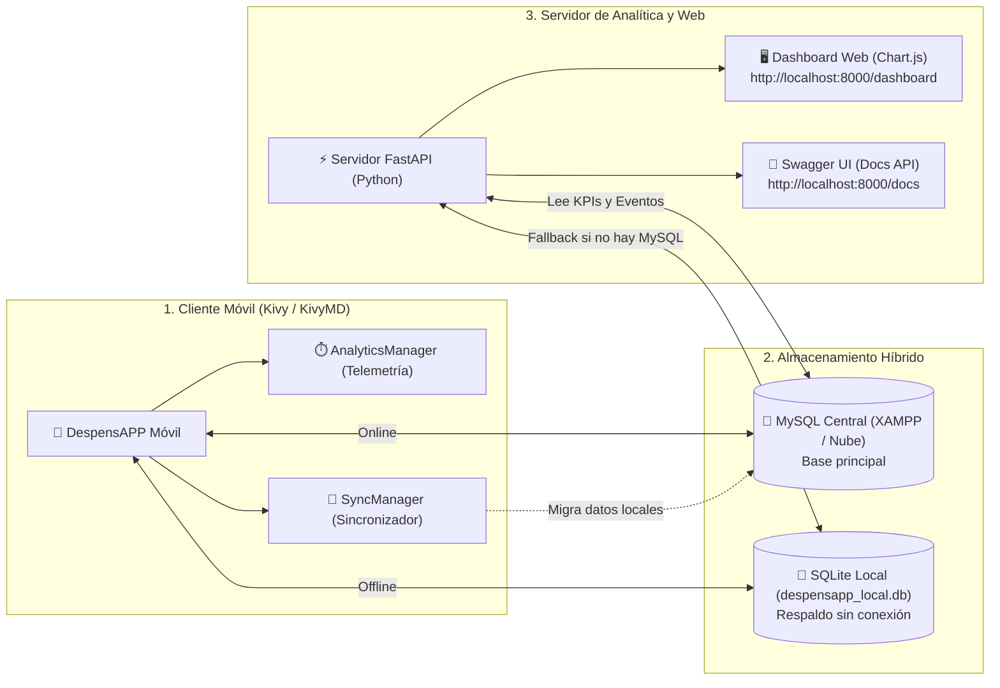

# Guía Completa de Funcionamiento - DespensAPP 🛒📖
> Manual explicativo, claro y didáctico sobre cómo funciona cada pieza del sistema DespensAPP: App Móvil, Base de Datos Híbrida, Telemetría, Servidor FastAPI y Motor de Sincronización.

---

## 🧭 1. Visión General del Ecosistema

DespensAPP no es solamente una aplicación móvil; es un **ecosistema completo de software** compuesto por 3 módulos principales que trabajan en sincronía:

---

## 📱 2. Cómo Funciona la Aplicación Móvil (Kivy & KivyMD)

### El Ciclo de Vida al Abrir la App
1. **Inicio en `main.py`:** Se configuran las dimensiones de pantalla estándar para móvil (`390 x 780` px) y se cargan las dependencias visuales.
2. **Pantalla de Bienvenida (*SplashScreen*):**
   - Muestra el isotipo de la hoja de DespensAPP y una barra de progreso que avanza en 3 fases:
     - **35%:** Establece conexión con la base de datos e inicializa la telemetría.
     - **70%:** Si hay una sesión previa guardada, sincroniza los datos del usuario e inventario.
     - **100%:** Pasa de forma fluida a la pantalla de Inicio (`home`).
3. **Navegación entre Pantallas:**
   - El menú inferior (*dock*) permite cambiar entre las 5 secciones principales:
     - 🏠 **Inicio (`home`):** Tarjetas de resumen diario (gasto de la semana, alertas de alimentos por vencer y receta recomendada).
     - 🛒 **Compras (`cart`):** Lista interactiva de supermercado donde puedes marcar/desmarcar casillas, ver precios y el total estimado a pagar.
     - 🥫 **Despensa (`cupboard`):** Inventario clasificado por categorías (Aceites, Legumbres, Bebidas) con etiquetas de stock (*Suficiente*, *Reponer*, *Por agotarse*).
     - 📋 **Listas (`lists`):** Listas temáticas personalizables con colores e iconos (ej. *Compra quincenal*, *Limpieza*).
     - 📊 **Estadísticas (`stats`):** Métricas reales de consumo (gasto mensual, productos comprados y ranking con barras de progreso).
4. **Modo Claro / Modo Oscuro:**
   - En el menú del avatar de usuario (`SO`), un interruptor permite alternar el tema visual. La paleta de colores reactiva (`theme.py`) redibuja los fondos y textos instantáneamente sin recargar la aplicación.

---

## 🗄️ 3. Cómo Funciona la Base de Datos Híbrida (MySQL vs. SQLite)

Uno de los puntos más sólidos del proyecto es su **arquitectura tolerante a fallos (*Graceful Degradation*)**:

### ¿Qué pasa cuando XAMPP está encendido?
1. La aplicación intenta conectarse al puerto `3306` de MySQL.
2. Al recibir respuesta, establece `is_mysql = True`.
3. Todas las lecturas y escrituras se realizan en la base de datos central `despensapp_db`.

### ¿Qué pasa si XAMPP está apagado o estás en un PC de la universidad sin XAMPP?
1. La app intenta conectarse a MySQL por 3 segundos.
2. Al no recibir respuesta (o denegarse la conexión), captura el error de forma segura en lugar de cerrarse.
3. Activa automáticamente el **Modo Local (SQLite)**:
   - Crea el archivo local [`despensapp_local.db`](file:///c:/Users/luisc/Desktop/DespensAPP/despensapp_local.db).
   - Genera todas las tablas necesarias idénticas a las de MySQL.
   - Inserta los datos iniciales de demostración de Sofía Martínez.
   - La aplicación funciona al 100% sin que el usuario note interrupciones.

---

## 🔐 4. Cómo Funciona la Autenticación y las Sesiones

La seguridad y persistencia de cuentas se maneja en [`auth_manager.py`](file:///c:/Users/luisc/Desktop/DespensAPP/auth_manager.py):

1. **Cifrado de Contraseñas:** Las contraseñas nunca se guardan en texto plano; se utiliza el algoritmo de hash unidireccional **SHA-256** (`hashlib.sha256`).
2. **Sesión Recordada ([`session.json`](file:///c:/Users/luisc/Desktop/DespensAPP/session.json)):**
   - Al iniciar sesión exitosamente, se guarda el `email` y `user_id` en un archivo local.
   - Cuando vuelves a abrir la app, lee este archivo y entra directamente a tu cuenta sin pedirte la clave otra vez.
3. **Salvaguardas de Seguridad sin Conexión:**
   - **Registro bloqueado offline:** Si estás en Modo Local (sin MySQL), la app bloquea la creación de cuentas nuevas. ¿Por qué? Porque crear un usuario localmente podría colisionar con un correo ya existente en el servidor central al momento de sincronizar.
   - **Login offline:** Solo se permite ingresar a cuentas que ya hayan sido utilizadas y almacenadas previamente en ese dispositivo.

---

## ⏱️ 5. Cómo Funciona el Motor de Telemetría (Métricas de Uso)

Ubicado en [`analytics_manager.py`](file:///c:/Users/luisc/Desktop/DespensAPP/analytics_manager.py), mide silenciosamente la experiencia de usuario:

1. **Duración de Sesiones:**
   - Al abrir la app, se crea un registro en la tabla `app_sessions` con la hora de inicio y la versión de la app.
   - Al cerrar la app (`on_stop`), calcula el tiempo transcurrido (en segundos) y cierra la sesión.
2. **Medición por Pantalla:**
   - Cada vez que el usuario presiona una pestaña en el menú inferior, el sistema calcula cuántos segundos estuvo en la pantalla anterior y guarda un evento `screen_view` en `app_events`.
   - Así se sabe exactamente si los usuarios pasan más tiempo en la Despensa o en el Carrito.
3. **Eventos de Acción:**
   - Cuando el usuario añade un producto, inicia sesión o crea una lista, se registra un evento puntual con fecha, hora y metadatos.

---

## 🖥️ 6. Cómo Funciona el Dashboard Web de Administrador

Construido en la carpeta [`admin_dashboard/`](file:///c:/Users/luisc/Desktop/DespensAPP/admin_dashboard) para que los desarrolladores o profesores monitoreen la app desde un navegador:

1. **Servidor FastAPI ([`admin_dashboard/server.py`](file:///c:/Users/luisc/Desktop/DespensAPP/admin_dashboard/server.py)):**
   - Es un servidor web de alto rendimiento basado en Python y Uvicorn.
   - Expone endpoints REST en formato JSON:
     - `GET /api/v1/analytics/kpis`: Devuelve usuarios totales, duración promedio de sesión, total de sesiones y sección más popular.
     - `GET /api/v1/analytics/screen-times`: Devuelve los minutos acumulados y vistas de cada pantalla.
     - `GET /api/v1/analytics/recent-events`: Devuelve los últimos 15 eventos registrados.
     - `GET /api/v1/health`: Estado del servidor y si está conectado a MySQL o SQLite.
2. **Panel Visual Reactivo ([`index.html`](file:///c:/Users/luisc/Desktop/DespensAPP/admin_dashboard/templates/index.html)):**
   - Se consulta en **`http://localhost:8000/dashboard`**.
   - Usa la librería **Chart.js** para renderizar gráficos en vivo (Dona para minutos y Barras para visitas).
   - Mediante JavaScript (`dashboard.js`), hace una petición cada **3 segundos** (*polling reactivo*). Si agregas un producto en la app móvil en tu teléfono o emulador, verás aparecer el evento en la tabla web automáticamente.
3. **Documentación Swagger ([`http://localhost:8000/docs`](http://localhost:8000/docs)):**
   - FastAPI genera automáticamente una interfaz interactiva donde se puede probar cada endpoint y ver su esquema JSON.

---

## 🔄 7. Cómo Funciona el Motor de Sincronización (*SyncEngine*)

Ubicado en [`sync_manager.py`](file:///c:/Users/luisc/Desktop/DespensAPP/sync_manager.py), resuelve el problema de los datos creados mientras no había internet o XAMPP estaba apagado:

### El Flujo de Sincronización Paso a Paso:
1. **Detección:** Cuando la aplicación inicia (o el usuario inicia sesión) y se comprueba que `is_mysql == True`, el sistema verifica si existe el archivo [`despensapp_local.db`](file:///c:/Users/luisc/Desktop/DespensAPP/despensapp_local.db).
2. **Mapeo por Correo:** Toma el `email` del usuario autenticado (ej. `sofia@despensapp.com`) y busca su `user_id` real en el servidor MySQL.
3. **Migración sin Duplicados:**
   - **Listas:** Si creaste una lista offline, la crea en MySQL y mapea su nuevo ID.
   - **Despensa:** Revisa si el producto ya existía en MySQL por nombre; si es nuevo, lo inserta.
   - **Compras:** Pasa los artículos del carrito respetando la lista a la que pertenecían.
   - **Métricas:** Sube las sesiones y eventos medidos offline para no perder el historial de uso.
4. **Limpieza:** Una vez migrado todo exitosamente, vacía la cola local para no duplicar datos en el futuro.

---

## 🗓️ 8. Control de Vencimientos y Listas de Supermercado Interactivas

Para adaptarse a los hábitos reales de compra y consumo del hogar, se implementaron dos módulos clave:

### A. Control Inteligente de Vencimientos en Despensa
1. **Productos Perecibles vs. No Perecibles:**
   - Al tocar el botón `+` en la pestaña Despensa, se abre `AddPantryItemModal`.
   - Si el alimento vence (ej: leche, yogur, carne), se ingresa la fecha en formato `AAAA-MM-DD` (ej: `2026-11-20`).
   - Si el producto es no perecible (ej: sal, azúcar, aceite de oliva, arroz), se presiona el botón **`✓ Sin fecha de vencimiento (no perecible)`**. La app guardará `NULL` en la base de datos y mostrará la etiqueta neutra `"Sin vencimiento"`.
2. **Alertas Visuales Automáticas:**
   - **Vence en <= 3 días:** Se resalta en color ámbar (`Vence en 2 días`, `Vence hoy`).
   - **Vencido:** Se resalta en color rojo intenso (`Venció hace 1d`).
   - **En buen estado:** Se mantiene en verde esmeralda o fecha formateada (`DD/MM/AAAA`).
3. **Prioridad en el Inicio (`home`):**
   - La tarjeta de alertas en el Inicio prioriza de forma automática cualquier alimento vencido o por caducar antes de las alertas de stock bajo.
4. **Modificación Rápida:**
   - Si compraste un nuevo lote o te equivocaste en la fecha, al tocar el producto en la despensa se abre `PantryItemDetailModal` y con el botón **`Cambiar`** puedes corregir la fecha al instante.

### B. Listas de Supermercado Interactivas (Estilo Papel)
1. **Creación con Productos Iniciales:**
   - Al crear una lista (ej: *"Asado del Domingo"*), puedes ingresar opcionalmente una lista de productos separados por comas (ej: *Carne, Carbón, Tomates, Bebidas*).
2. **Experiencia de Lista de Papel (Sin Precios):**
   - Al pulsar la tarjeta de la lista, se abre `ShoppingListDetailModal`.
   - No tiene precios obligatorios ni campos complejos; funciona exactamente como un papel donde anotaste lo que vas a comprar.
   - **Tachado interactivo:** Conforme encuentras los productos en el supermercado, tocas el círculo verde y el producto queda tachado con estilo tachado (`[s]producto[/s]`) y opacidad suave.
   - **Corrección de nombres (✎):** Si tuviste un error tipográfico al escribir, tocas el lápiz y corriges el nombre al instante.
   - **Anotar más productos (+):** En la parte superior hay un campo rápido donde escribes y presionas `+` (o enter) para agregar un producto adicional sobre la marcha.
   - **Contador en vivo:** Indica cuántos productos tienes anotados y cuántos ya tachaste (ej: *4 productos anotados · 2 tachados*).

---

## 🎓 9. Guía para la Defensa / Presentación en Clases

Si tienes que presentar este proyecto ante un profesor o comisión, sigue esta demostración en vivo recomendada:

### La Demostración en Vivo (Paso a Paso)
1. **Paso 1 (Levantar el Dashboard Web):**
   - Ejecuta `iniciar.bat` y selecciona la opción `[2]` (o ejecuta `python admin_dashboard/server.py`).
   - Abre tu navegador en `http://localhost:8000/dashboard`.
   - Explica: *"Este es nuestro panel de desarrollador en FastAPI para monitorear el comportamiento de los usuarios en tiempo real"*.
2. **Paso 2 (Abrir la App Móvil):**
   - En otra terminal o con la opción `[1]` de `iniciar.bat`, abre la app (`python main.py`).
   - Muestra la pantalla de bienvenida con su barra de carga progresiva.
3. **Paso 3 (Demostrar la Telemetría en Vivo):**
   - Navega en la app móvil: cambia a la Despensa y agrega un producto (ej. *"Leche de Almendras"*).
   - Vuelve a mirar el navegador: verás cómo en menos de 3 segundos el gráfico de barras se mueve y el evento `pantry_item_added` aparece en el Live Feed.
4. **Paso 4 (Mostrar la API Swagger):**
   - Abre `http://localhost:8000/docs` y ejecuta el endpoint `/api/v1/analytics/kpis` en vivo para que vean el JSON estructurado.

### Preguntas Frecuentes de Profesores y Cómo Responderlas

- **P: ¿Por qué usaron SQLite y MySQL al mismo tiempo?**
  > *R: Implementamos un patrón Offline-First con degradación elegante. Si el servidor central falla o el usuario no tiene conexión, la app no se bloquea; opera en una base local SQLite y, en cuanto detecta conexión, nuestro SyncEngine migra los datos a MySQL sin duplicados.*

- **P: ¿Por qué construyeron el dashboard en una página Web en vez de otra app móvil?**
  > *R: Porque las consolas de administración y telemetría están pensadas para equipos de desarrollo y negocio, quienes trabajan desde computadoras de escritorio. FastAPI nos permite además ofrecer una API REST estándar con Swagger para integrar futuras plataformas.*

- **P: ¿Cómo protegen las contraseñas?**
  > *R: Con funciones hash criptográficas unidireccionales SHA-256. La base de datos nunca almacena contraseñas legibles, solo su resumen hash.*
