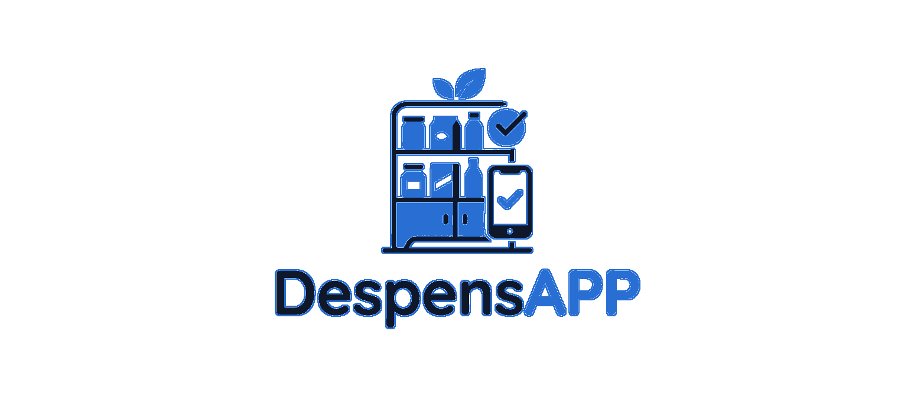

<p align="center">
  
</p>

# DespensAPP 🛒📊
> App móvil para controlar lo que tienes en casa, anotar lo que falta y registrar lo que gastas en el supermercado. Incluye un panel web de analítica para desarrolladores con la telemetría de uso en tiempo real.

---

## ✨ Qué hace la app

La app tiene cuatro pestañas:

| Pestaña | Para qué sirve |
|---|---|
| 🏠 **Inicio** | Resumen del día: gasto de la última semana, productos por vencer o por agotarse y alertas (campana). |
| 🥫 **Despensa** | Inventario ordenado por urgencia (*Necesita atención*, *Por agotarse*, *Todo bien*), con buscador sin tildes, filtros, categorías, ícono según el producto y botones `−`/`+` para ajustar el stock al instante. |
| 📋 **Listas** | Cada lista funciona como carrito: anotas productos con precio opcional, los tachas al echarlos al carro y **Finalizar compra** los pasa a la despensa y al historial. |
| 📊 **Estadísticas** | Gasto por semana, mes o año, la última compra con **Ver todas** para el historial completo y lo más comprado. |

Además:
- **Notificaciones** del sistema cuando algo vence o se agota.
- **Deshacer** al eliminar productos de la despensa o listas.
- **Modo claro y oscuro**.
- **Funciona sin internet**: guarda en SQLite y sincroniza con MySQL cuando está disponible.

El detalle de cada pantalla está en [docs/GUIA_FUNCIONAMIENTO.md](docs/GUIA_FUNCIONAMIENTO.md).

---

## 🚀 Cómo ejecutar el proyecto

El proyecto es **portable**: en cualquier computadora solo necesitas **Python entre 3.10 y 3.12**.

> ⚠️ **Evita Python 3.13 o superior:** Kivy 2.3.1 suele dar problemas de instalación con esas versiones.

### Opción 1: Un solo clic (recomendada en Windows)
Haz doble clic en `iniciar.bat`. El script:
1. Detecta tu instalación de Python.
2. Crea el entorno virtual (`venv`) si no existe.
3. Instala las dependencias de `requirements.txt`.
4. Muestra un menú para abrir la **App Móvil**, el **Dashboard Web** o ambos, y para reinstalar dependencias.

### Opción 2: Desde la terminal (PowerShell)

1. Clona el repositorio:
   ```bash
   git clone <URL_DEL_REPOSITORIO>
   cd DespensAPP
   ```
2. Crea y activa el entorno virtual:
   ```powershell
   python -m venv venv
   .\venv\Scripts\Activate.ps1
   ```
3. Instala las dependencias:
   ```powershell
   pip install -r requirements.txt
   ```
4. Ejecuta la app móvil:
   ```powershell
   python main.py
   ```
5. *(Opcional)* Ejecuta el Dashboard Web de analítica en otra terminal:
   ```powershell
   python admin_dashboard/server.py
   ```
   - **Panel web:** [http://localhost:8000/dashboard](http://localhost:8000/dashboard)
   - **Documentación Swagger / OpenAPI:** [http://localhost:8000/docs](http://localhost:8000/docs)

---

## 🗄️ Base de datos: no necesitas XAMPP

- **Si MySQL (por ejemplo, XAMPP) está encendido:** la app se conecta a `despensapp_db` en el puerto `3306`. Los datos de conexión se toman de `db_config.json` en la raíz del proyecto; puedes crearlo copiando `database/db_config.example.json`.
- **Si MySQL no está instalado o está apagado:** la app usa automáticamente **SQLite local** (`despensapp_local.db`), sin configurar nada:
  - crea todas las tablas;
  - carga datos de demostración;
  - registra la telemetría.

  Lo que guardes sin conexión se sincroniza con MySQL la próxima vez que inicies sesión con MySQL disponible.

### Usuario de demostración
- **Correo:** `sofia@despensapp.com`
- **Contraseña:** `despensapp123`

---

## 🏛️ Estructura del proyecto (MVC)

```text
DespensAPP/
│
├── controllers/                  # [C] Lógica de negocio y eventos
│   ├── main_controller.py        # Orquestador central de pantallas y estado
│   ├── auth_controller.py        # Registro, inicio de sesión y hash SHA-256
│   ├── analytics_controller.py   # Telemetría de eventos y tiempos de pantalla
│   ├── sync_controller.py        # Sincronización SQLite → MySQL
│   ├── purchase_controller.py    # Finalizar compras, historial y gasto por periodo
│   ├── list_controller.py        # Listas de compras
│   ├── pantry_controller.py      # Despensa: stock, vencimientos y alertas
│   ├── pantry_organizer.py       # Orden por urgencia, búsqueda, filtros y categorías
│   ├── product_icons.py          # Ícono según el producto y categoría sugerida
│   ├── notification_controller.py# Notificaciones del sistema (Plyer) sin spam
│   ├── undo_controller.py        # Borrado diferido con "Deshacer"
│   ├── remote_config_controller.py # Configuración remota (banners, feature flags)
│   └── validators.py             # Validación de formularios y formato de números
│
├── models/                       # [M] Entidades y persistencia
│   ├── user.py                   # Usuario
│   ├── pantry_item.py            # Producto de despensa con estado y vencimiento
│   ├── shopping_list.py          # Listas y productos anotados
│   ├── purchase_record.py        # Compras finalizadas
│   ├── cart_item.py              # Carrito antiguo (solo migración y sincronización)
│   └── database.py               # Persistencia híbrida (MySQL + SQLite local)
│
├── views/                        # [V] Interfaz gráfica
│   ├── theme.py                  # Paletas de color para modo claro y oscuro
│   ├── widgets/                  # Filas, tarjetas, chips, botones y avisos
│   └── dialogs/                  # Modales: formularios, detalle, alertas e historial
│
├── kv/                           # Plantillas declarativas de Kivy
│   ├── components.kv             # Componentes reutilizables
│   ├── dialogs.kv                # Diseño de los modales
│   └── screens/                  # home, pantry, lists, stats y splash
│
├── database/
│   ├── database_schema.sql       # Esquema MySQL (tablas de la app y telemetría)
│   └── db_config.example.json    # Plantilla de conexión a MySQL
│
├── docs/
│   ├── GUIA_FUNCIONAMIENTO.md    # Manual detallado de la aplicación
│   ├── HISTORIAL_CAMBIOS.md      # Registro cronológico de versiones
│   ├── FUNDAMENTACION-UX-UI.md   # Sustento del diseño de experiencia
│   ├── uso_ia.md                 # Bitácora de asistencia por IA
│   └── despensapp_logo.png       # Logo de la aplicación
│
├── admin_dashboard/              # Panel web de analítica (FastAPI)
│   ├── server.py                 # API REST y vistas Jinja2
│   ├── Dockerfile                # Contenedor para desplegar en la nube
│   ├── requirements.txt          # Dependencias del panel por separado
│   ├── templates/                # Panel interactivo con Chart.js
│   └── static/                   # Estilos y actualización periódica (polling)
│
├── main.py                       # Punto de entrada de la app (Kivy / KivyMD)
├── main.kv                       # Raíz de navegación
├── remote_config.json            # Configuración remota local (respaldo sin conexión)
├── iniciar.bat                   # Lanzador y configurador automático para Windows
└── requirements.txt              # Dependencias del proyecto
```

---

## 🧰 Tecnologías

- **App:** Python 3.12, Kivy 2.3.1, KivyMD 2.0.0 y Plyer.
- **Datos:** MySQL (PyMySQL) con respaldo en SQLite.
- **Panel web:** FastAPI, Uvicorn, Jinja2 y Chart.js.
